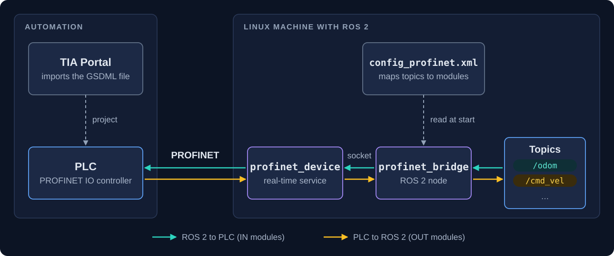

<h1 align="center">ros2-profinet</h1>

<p align="center">
  <b>Make a ROS 2 machine a modular PROFINET IO device.</b>
</p>

<p align="center">
  <a href="https://github.com/becheanucornel/ros2-profinet/tree/humble"></a>
  <a href="https://github.com/becheanucornel/ros2-profinet/tree/jazzy"></a>
  <a href="https://github.com/becheanucornel/ros2-profinet/tree/lyrical"></a>
  
  <a href="#license"></a>
</p>

<p align="center">
  <a href="#quick-start">Quick start</a> ·
  <a href="docs/installation.md">Installation</a> ·
  <a href="docs/configuration.md">Configuration</a> ·
  <a href="gsdml/README.md">TIA Portal</a> ·
  <a href="docs/troubleshooting.md">Troubleshooting</a>
</p>

<p align="center">
  
</p>

## Overview

The PLC engineer imports one GSDML file in TIA Portal and places modules, as with any
other field device. The ROS 2 engineer writes one XML file that maps topics to these
modules. Neither side needs code or a generator.

The project has no vendor ID and no device ID of its own. Each organisation puts in its
own, once, so that its machines are devices of that organisation.

## Supported distributions

Each ROS 2 distribution has its own branch:

| ROS 2 | Ubuntu | Branch |
|---|---|---|
| Humble Hawksbill | 22.04 | [`humble`](https://github.com/becheanucornel/ros2-profinet/tree/humble) |
| Jazzy Jalisco | 24.04 | [`jazzy`](https://github.com/becheanucornel/ros2-profinet/tree/jazzy) |
| Lyrical Luth | 26.04 | [`lyrical`](https://github.com/becheanucornel/ros2-profinet/tree/lyrical) |

`main` is for development. The GSDML file is the same in all branches, so the PLC
project does not depend on the distribution.

## Features

| Feature | Description |
|---|---|
| **Modular** | 40 modules in up to 31 slots. Use only those you need. |
| **Configured in XML** | To change a mapping, edit the file and restart the node. |
| **Field-level mapping** | Each field of a message goes to its own address in a module. |
| **Data status** | Old or invalid data is marked as bad for the PLC. |
| **Defined reaction to faults** | If the PLC is lost, each topic stops, becomes zero or holds, as configured. |
| **Process separation** | PROFINET runs in a service of its own. A crash of the ROS 2 node does not disturb the PLC connection. |

### Modules

| Type | Elements | To the PLC | From the PLC |
|---|---|---|---|
| BOOL | 8, 16, 32 | `BOOL_8_IN` … | `BOOL_8_OUT` … |
| INT | 1, 2, 4, 8 | `INT_1_IN` … | `INT_1_OUT` … |
| DINT | 1, 2, 4, 8 | `DINT_1_IN` … | `DINT_1_OUT` … |
| REAL | 1, 2, 4, 8, 16 | `REAL_1_IN` … | `REAL_1_OUT` … |
| RAW (bytes, mixed types) | 8, 16, 32, 64 | `RAW_8_IN` … | `RAW_8_OUT` … |

## Quick start

### Requirements

- A ROS 2 distribution and Ubuntu version from the table above
- `sudo apt install build-essential cmake git python3-colcon-common-extensions`
- A network port that is used only for PROFINET
- TIA Portal, or another engineering tool for GSDML V2.4
- The [vendor ID of your organisation and a device ID](gsdml/README.md#1-your-ids)

### 1. Install

```sh
cd ~/ros2_ws/src
git clone -b <branch> https://github.com/becheanucornel/ros2-profinet.git

# PROFINET service, once per machine
cd ros2-profinet/profinet_device
sh third_party/fetch.sh
cmake -S . -B build -DCMAKE_BUILD_TYPE=Release
cmake --build build
sudo groupadd --system profinet
sudo usermod -aG profinet $USER      # log in again afterwards
sudo cmake --install build

# ROS 2 package
cd ~/ros2_ws
colcon build && . install/setup.sh
```

### 2. Set up the PLC

Put your IDs into a copy of [the GSDML file](gsdml), import it in TIA Portal, add
**ROS 2 device** to the project, and place the modules. Details:
[gsdml/README.md](gsdml/README.md).

### 3. Map the topics

Write `config_profinet.xml` with the same IDs, and the same modules in the same slots:

```xml
<profinet vendor_id="YOUR_VENDOR_ID" device_id="YOUR_DEVICE_ID"
          station_name="ros2-robot" interface="eth1" cycle_ms="10">

  <!-- Topic to PLC -->
  <slot number="2" module="REAL_2_IN">
    <map topic="/odom" type="nav_msgs/msg/Odometry" timeout_ms="200">
      <field path="twist.twist.linear.x" offset="0"/>
      <field path="twist.twist.angular.z" offset="4"/>
    </map>
  </slot>

  <!-- PLC to topic -->
  <slot number="4" module="REAL_2_OUT">
    <map topic="/cmd_vel" type="geometry_msgs/msg/Twist" rate_hz="20" on_disconnect="zero">
      <field path="linear.x" offset="0"/>
      <field path="angular.z" offset="4"/>
    </map>
  </slot>

</profinet>
```

All settings: [docs/configuration.md](docs/configuration.md).

### 4. Run

Check the file, and give its IDs, network port and station name to the service:

```sh
ros2 run profinet_bridge profinet_check config_profinet.xml
ros2 run profinet_bridge profinet_check --service-env config_profinet.xml | sudo tee /etc/default/profinet_device
sudo systemctl daemon-reload
sudo systemctl enable --now profinet_device
```

Start the node:

```sh
ros2 launch profinet_bridge profinet.launch.py config:=/path/to/config_profinet.xml
```

`profinet_check` also prints a mapping ID. Let the PLC program compare it with the one
it receives, so that it notices if someone has changed the file.

## Documentation

| Document | Content |
|---|---|
| [Installation](docs/installation.md) | Install, add to a project, update |
| [Configuration](docs/configuration.md) | Every setting of `config_profinet.xml` |
| [TIA Portal](gsdml/README.md) | GSDML file, modules, Node status |
| [Troubleshooting](docs/troubleshooting.md) | Behaviour on faults, and what to look at |
| [Design](docs/design.md) | How it works inside |
| [Third-party software](profinet_device/third_party/README.md) | p-net, and the patches it needs |

## Repository layout

| Folder | Content |
|---|---|
| [`gsdml`](gsdml) | GSDML file for TIA Portal |
| [`profinet_bridge`](profinet_bridge) | ROS 2 package: node, launch file and example configuration |
| [`profinet_device`](profinet_device) | PROFINET service, based on [p-net](https://github.com/rtlabs-com/p-net) |
| [`docs`](docs) | Documentation |

## Project status

Early version. It has not been used with a real PLC yet.

> [!WARNING]
> This is **not a safety system**. Emergency stops and other safety functions need a
> separate channel.

- Not certified by PROFIBUS & PROFINET International (PI). An organisation that puts a
  device on the market is responsible for its certification.
- Start with an update time of 8 ms or more.

## Contributing

Issues and pull requests are welcome. Please open pull requests against `main`; changes
are then merged into the distribution branches.

## License

[Apache-2.0](LICENSE), except `profinet_device`, which is
[GPL-3.0-only](profinet_device/LICENSE) because it is based on p-net v0.2.0.

PROFINET is a trademark of PROFIBUS Nutzerorganisation e.V. (PNO). TIA Portal is a
product of Siemens AG. This project is not affiliated with either of them.
